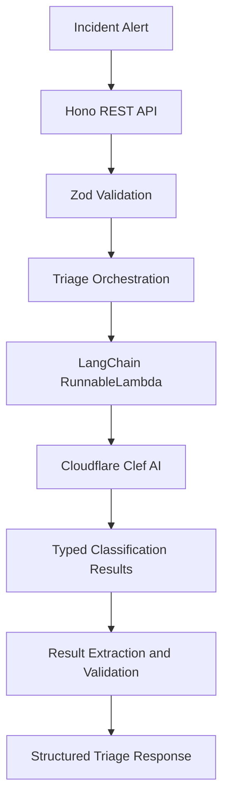

<div align="center">

  <h1>Nova — Intelligent Incident Triage</h1>

  <p>
    
    
    
    
    
    
  </p>

</div>

Nova is an AI-powered incident triage platform that analyzes operational alerts, classifies their severity, identifies the most appropriate response team, and determines whether immediate attention is required.

It combines **Cloudflare Clef AI, LangChain's `RunnableLambda`, and a structured incident-triage pipeline** to transform unstructured incident descriptions into actionable classification results.

## Key Features

- **AI-Powered Incident Classification:** Analyzes incident titles, descriptions, affected services, environments, alert sources, and metadata.
- **Severity Detection:** Classifies incidents as `low`, `medium`, `high`, or `critical`.
- **Intelligent Team Assignment:** Recommends a responsible team based on incident context.
- **Urgency Assessment:** Evaluates whether an incident requires immediate attention.
- **Structured AI Outputs:** Extracts classification results from Clef's typed responses.
- **Input Validation:** Uses Zod schemas to validate incoming alerts and enforce consistent data structures.
- **API-Based Processing:** Exposes an HTTP endpoint for submitting incidents and retrieving classification results.
- **Error Handling:** Handles malformed JSON, invalid inputs, AI service failures, and unexpected errors.
- **Extensible Architecture:** Organizes AI integration, triage logic, shared schemas, and API handling into separate packages.

## How It Works

Nova follows a structured pipeline from incident submission to classification.



1. **Incident submission:** An alert containing incident details is submitted to the API.
2. **Validation:** Zod validates required fields, data types, string limits, and default values.
3. **Triage orchestration:** The triage package prepares the incident context and the classification criteria.
4. **Runnable execution:** A LangChain `RunnableLambda` encapsulates the call to Cloudflare Clef.
5. **AI inference:** Clef evaluates the incident and returns structured answers for severity, team assignment, and urgency.
6. **Result extraction:** Nova extracts the relevant values, checks that classifications match supported categories, and converts urgency into a boolean.
7. **Response generation:** The API returns a structured JSON result containing the incident classification and supporting metadata.

## Understanding the AI Integration

### 1. Cloudflare Clef AI

Nova uses Cloudflare Clef as its classification engine. Rather than relying solely on manually defined keyword rules, it evaluates the supplied incident context against the classification criteria.

The model produces typed answers for different classification tasks:

| Task | Output | Purpose |
|---|---|---|
| Severity classification | `choice` | Determines incident severity |
| Team assignment | `choice` | Recommends the responsible team |
| Urgency assessment | `noul` | Provides a numerical urgency score |

The team and severity classifications include confidence or probability information where provided by Clef. The urgency assessment is converted into a boolean using Nova's configured threshold.

### 2. LangChain `RunnableLambda`

`RunnableLambda` provides a standard LangChain interface for executing the custom Clef integration.

Nova uses it to encapsulate the Cloudflare API call in a reusable runnable instead of mixing external AI communication directly into the incident-processing logic.

Its responsibilities include:

- Preparing and forwarding the classification request.
- Sending the request to Cloudflare's Clef inference endpoint.
- Using the configured Cloudflare account credentials.
- Handling unsuccessful API responses and missing configuration.
- Returning the AI response to the triage pipeline for extraction and validation.

This separation allows the triage logic to work with a consistent runnable interface while keeping provider-specific communication isolated.

### 3. Structured Result Extraction

Clef returns typed answers rather than requiring Nova to interpret a free-form paragraph for every classification.

For example, a team answer can contain:

```json
{
  "type": "choice",
  "choice": "payments",
  "confidence": 0.8831
}
```

Nova reads the selected team from `answers.team.choice`, validates the selection against the supported team categories, and uses it in the final incident result.

Similarly, the urgency score is read from `answers.urgent.noul`, while severity is extracted from `answers.severity.choice`.

This approach separates model inference from application-level validation and result formatting.

## Incident Classification

### Severity Levels

| Severity | Meaning |
|---|---|
| `low` | Limited impact or a minor operational issue |
| `medium` | Noticeable issue requiring investigation |
| `high` | Significant service degradation or operational impact |
| `critical` | Potentially severe disruption requiring prompt attention |

These descriptions explain the intended meaning of each category; the actual classification is generated by Clef from the incident context.

### Team Assignment

Nova currently supports four team categories:

| Team | Example responsibility |
|---|---|
| `payments` | Payment processing and transaction failures |
| `backend` | Application APIs and business logic |
| `database` | Database connectivity and query-related issues |
| `platform` | Infrastructure and runtime-related issues |

The AI recommends a team based on the supplied alert and the criteria provided to the model. This is a classification recommendation, not a live lookup of team availability or an on-call schedule.

### Urgency Assessment

Clef returns a numerical urgency score. Nova compares it against the configured urgency threshold of `0.5` to derive the final boolean urgency field.

Conceptually:

```ts
urgent = urgencyScore >= URGENCY_THRESHOLD;
```

An urgent result indicates that the incident should receive immediate attention according to the model's assessment. It does not independently establish the incident's real-world impact.

## Example

Consider an incoming alert:

```json
{
  "title": "Checkout service outage",
  "description": "Payment requests are failing, preventing customers from completing purchases.",
  "source": "Application monitoring",
  "service": "checkout",
  "severity": "medium",
  "environment": "production",
  "metadata": {}
}
```

Nova sends the validated incident context through the Clef classification pipeline.

An example classification result could be:

```json
{
  "data": {
    "incidentId": "example-incident-id",
    "severity": "critical",
    "team": "payments",
    "urgent": true,
    "summary": "checkout: Checkout service outage",
    "reasoning": "Severity classified as critical. Assigned to the payments team. Immediate investigation is recommended.",
    "status": "open",
    "createdAt": "2026-10-15T04:40:00.000Z"
  }
}
```

*The classification values are illustrative; actual results depend on the incident context and Clef's response.*

The final result provides a consistent representation of the incident that can be consumed by other services, operational workflows, or a user interface.

## API Reference

### Health Check

`GET /health`

Checks whether the API is running.

Example response:

```json
{
  "status": "ok",
  "service": "nova-api"
}
```

### Classify an Incident

`POST /incidents/triage`

Submits an incident for AI-powered classification.

**Request body:**

```json
{
  "title": "Checkout service outage",
  "description": "Payment requests are failing.",
  "source": "Application monitoring",
  "service": "checkout",
  "severity": "medium",
  "environment": "production",
  "metadata": {}
}
```

**Successful response:** `200 OK`

Returns a `data` object containing the incident ID, classified severity, recommended team, urgency, summary, reasoning, status, and creation timestamp.

**Error responses:**

| Status code | Meaning |
|---|---|
| `400 Bad Request` | Invalid JSON or invalid incident fields |
| `404 Not Found` | Requested route does not exist |
| `502 Bad Gateway` | Incident classification failed because of an upstream or processing error |

## Technology Stack

| Technology | Role |
|---|---|
| TypeScript | Type-safe application logic |
| Bun Workspaces | Package management and monorepo execution |
| LangChain `RunnableLambda` | Reusable abstraction for executing the Clef integration |
| Cloudflare Clef AI | AI-powered incident classification |
| Hono | REST API and request handling |
| Zod | Input validation and result schema enforcement |
| Next.js | Interface for submitting incidents and viewing classifications |

## Project Structure

```text
nova/
├── apps/
│   ├── api/                  # Hono REST API
│   └── playground/           # Incident submission and results
├── packages/
│   ├── clef/                 # Cloudflare Clef runnable
│   ├── triage/               # Incident classification orchestration
│   ├── shared/                # Shared Zod schemas and types
│   └── database/             # Reserved for future persistence
├── tests/
├── .env.example
├── package.json
├── tsconfig.json
└── bun.lock
```

## Getting Started

### Prerequisites

- [Bun](https://bun.sh/)
- A Cloudflare account with access to the Clef inference endpoint
- A Cloudflare account ID and API token with the required permissions

### 1. Clone the Repository

```bash
git clone <your-repository-url>
cd nova
```

### 2. Install Dependencies

```bash
bun install
```

### 3. Configure Environment Variables

Create a `.env` file in the repository root:

```env
CLOUDFLARE_ACCOUNT_ID=your_cloudflare_account_id
CLOUDFLARE_API_TOKEN=your_cloudflare_api_token
PORT=3000
PLAYGROUND_ORIGIN=http://localhost:3001
```

Use the exact environment variable names expected by your implementation. Keep `.env` out of version control and never expose your API token in client-side code.

### 4. Start the API

```bash
bun dev:api
```

The API runs at `http://localhost:3000`.

Verify it with:

```bash
curl http://localhost:3000/health
```

### 5. Start the Playground

In another terminal:

```bash
bun dev:playground
```

Open `http://localhost:3001` to submit incidents and inspect their classification results.

### 6. Run Tests

```bash
bun test
```

Run the TypeScript check if configured in the root scripts:

```bash
bun run typecheck
```

## Reliability and Validation

Nova separates input validation, AI execution, and response construction to make incident processing easier to maintain and test.

- Incoming alerts are validated before reaching the AI integration.
- Required fields and allowed classification categories are checked.
- Missing Cloudflare credentials are handled by the Clef integration.
- External AI failures are caught by the API and returned as structured errors.
- The triage package can be tested independently of external AI calls.
- Classification results use shared schemas to maintain consistent response shapes.

AI-generated classifications should still be reviewed for high-impact incidents. Confidence values and model outputs are signals, not guarantees of correctness.

---

**Nova — Turning incident alerts into actionable classifications.**
